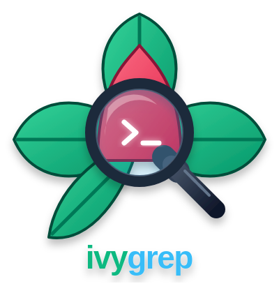
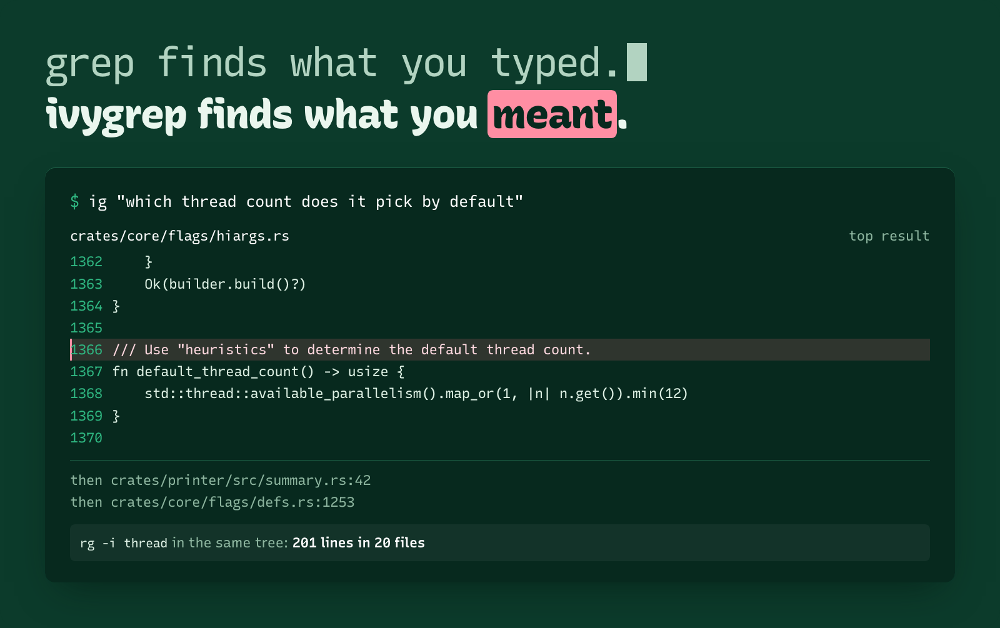

<p align="center">
  
</p>

<p align="center">
  <strong>grep finds what you typed. ivygrep finds what you meant.</strong><br/>
  Local search for code and notes, and context packs for coding agents.
</p>

<p align="center">
  <a href="https://github.com/bvolpato/ivygrep/releases/latest"></a>
  <a href="https://github.com/bvolpato/ivygrep/actions/workflows/ci.yml"></a>
  <a href="https://github.com/bvolpato/ivygrep/actions/workflows/security.yml"></a>
  <a href="LICENSE"></a>
</p>

<p align="center">
  <a href="https://bvolpato.github.io/ivygrep/">Website</a> ·
  <a href="docs/guide.md">User guide</a> ·
  <a href="#connect-a-coding-agent">Coding agents</a> ·
  <a href="https://bvolpato.github.io/ivygrep/benchmarks/">Benchmarks</a> ·
  <a href="docs/architecture.md">Architecture</a> ·
  <a href="https://github.com/bvolpato/ivygrep/discussions">Discussions</a>
</p>

<p align="center">
  
</p>

<p align="center">Recorded with ig 1.3.6 on the ripgrep 16.0.0 source.</p>

## What it does

- **Answers questions about code.** Ask in plain words and get ranked files, line numbers, and previews. Exact text, symbols, references, and callers use the same index.
- **Feeds coding agents.** `ig context` builds one evidence pack for a task: the code, its definitions, callers, dependencies, and tests, within a token budget. Claude Code, Codex, Cursor, Gemini CLI, OpenCode, and other MCP clients can call it.
- **Stays on your machine.** Files, queries, embeddings, and indexes are local. There is no account and no telemetry. The default model downloads 33.5 MB of pinned assets on first use and runs on CPU.
- **Keeps up.** A daemon watches your files and updates what changed. Git worktrees share one base index.

ivygrep runs on macOS, Linux, and Windows. It supports 45 language and file types.

## Install

| Platform | Command |
| --- | --- |
| macOS, Linux | `brew install bvolpato/tap/ivygrep` |
| macOS, Linux | `curl -fsSL https://raw.githubusercontent.com/bvolpato/ivygrep/main/install.sh \| sh` |
| Windows | `winget install --id BrunoVolpato.ivygrep --exact` |
| Windows | `irm https://raw.githubusercontent.com/bvolpato/ivygrep/main/install.ps1 \| iex` |

Every method installs one binary, `ig`. The installers select a compatible build and verify its SHA-256 checksum. WinGet can lag GitHub releases. The guide covers [builds, source installation, upgrades, and removal](docs/guide.md#install-upgrade-and-remove).

## Start in one minute

Open a repository and ask a question. The first query builds the index.

```bash
cd your-project
ig "where is refresh token rotated?"
```

Build context for a task. On a branch, `--since main` adds your changes.

```bash
ig context "fix refresh-token races" --since main --budget 8000
```

Connect your coding agent.

```bash
ig agent install claude     # or: codex, cursor
```

## Search

| You want | Command |
| --- | --- |
| Code by intent | `ig "where is authentication handled?"` |
| An exact string | `ig --literal "handleAuth"` |
| A definition | `ig --symbol calculate_tax` |
| Every use of a symbol | `ig --refs calculate_tax` |
| Functions that call it | `ig --callers calculate_tax` |
| One directory or file | `ig "database migrations" src/api/` |
| One language | `ig "retry policy" --type rust` |
| A match without a term | `ig "settings NOT render"` |
| All indexed projects | `ig --all "retry policy"` |
| A terminal UI | `ig --interactive` |
| A Web UI | `ig --web` |

Use `-n` to limit result files, `-C` for context lines, `--include` and `--exclude` for path globs, and `--json` for scripts. Use `--hash` to search without a model download. `ig --help` lists every option, and the [user guide](docs/guide.md#search) explains the rules.

## Build context for a task

```bash
ig context "fix refresh-token races" --since main --budget 8000
pytest 2>&1 | ig context -
```

A context pack starts from your task, from paths in pasted text, and from your Git changes. It adds definitions, callers, references, dependencies, dependents, tests, configuration, and docs. It stops at the token budget.

Each item names its file and lines, its role, and the reason for its selection:

```text
### 1. src/auth/refresh.rs:118-166 [primary, definition]
Why: task anchor; changed implementation.
Signals: lexical, symbol, git change.
```

A pack is evidence to read. It does not generate an answer or change files. See [how `--since` selects changes](docs/guide.md#context-packs).

## Connect a coding agent

The setup command keeps your existing configuration, verifies the MCP handshake, and runs a search. Restart an open client afterward.

```bash
ig agent install claude
ig agent install codex
ig agent install cursor
ig agent doctor
```

Plugins for Claude Code and Codex also install a task-context skill:

```bash
claude plugin marketplace add bvolpato/ivygrep
claude plugin install ivygrep@ivygrep

codex plugin marketplace add bvolpato/ivygrep
codex plugin add ivygrep@ivygrep
```

<details>
<summary>Manual MCP setup</summary>

```bash
claude mcp add -s user ig -- ig --mcp
codex mcp add ig -- ig --mcp
gemini mcp add --scope user --transport stdio ig ig --mcp
```

Cursor, in `.cursor/mcp.json`:

```json
{"mcpServers":{"ig":{"type": "stdio", "command": "ig", "args": ["--mcp"]}}}
```

OpenCode, in `opencode.json`:

```json
{"mcp":{"ig":{"type": "local", "command": ["ig", "--mcp"], "enabled": true}}}
```

</details>

Add this to your agent instructions:

```text
Use ivygrep before broad filesystem scans. Pass the absolute active worktree path.
Use natural-language queries for concepts and literal=true for identifiers.
For implementation, request output=context_pack with budget_tokens=8000.
```

Guides: [Claude Code](https://bvolpato.github.io/ivygrep/integrations/claude-code.html), [Codex](https://bvolpato.github.io/ivygrep/integrations/codex.html), [Cursor](https://bvolpato.github.io/ivygrep/integrations/cursor.html), [Gemini CLI](https://bvolpato.github.io/ivygrep/integrations/gemini-cli.html), [OpenCode](https://bvolpato.github.io/ivygrep/integrations/opencode.html), [MCP](https://bvolpato.github.io/ivygrep/integrations/mcp.html).

## Search notes

Index a notes directory once. The watcher keeps it current.

```bash
ig --add ~/notes --wait-for-enhancement
ig "what did we decide about cache invalidation?" ~/notes
```

## Privacy

| Data | Leaves your machine |
| --- | --- |
| Source, notes, queries, and results | No |
| Embeddings and indexes | No |
| Telemetry | None exists |
| The default model | One download of pinned assets. `--hash` avoids it. |
| The Web UI | Binds to loopback by default and requires a session token |

Read [Web UI security](docs/guide.md#web-ui) before you bind the Web UI to another address. Report vulnerabilities through a [private security advisory](SECURITY.md).

## How it works

1. A Git-aware walker finds changed and indexable files.
2. Tree-sitter splits 24 languages into functions and classes. Other files use text chunks.
3. SQLite stores metadata and relationships, Tantivy stores keywords, and USearch stores vectors.
4. Keyword and exact search work first. Background workers then add hash vectors and neural vectors.
5. A query runs bounded exact, keyword, symbol, hash, and neural passes, then ranks the files.

Read the [architecture](docs/architecture.md) for storage, retrieval, worktrees, protocols, and security boundaries.

## Measured results

| What | Result | Scope |
| --- | --- | --- |
| Issue text to a fixed file | Top 1: 47%, top 5: 70% | 30 issues from 10 open source projects, v1.3.5 ([method and losses](docs/benchmarks/file-localization.md)) |
| Context pack contains a fixed file | 77% | Same issues, 4,172 tokens on average |
| Notes retrieval | 74.9% recall@20 | MemoryQuest, v1.2.7 ([report](https://bvolpato.github.io/ivygrep/benchmarks/public-memory-retrieval.html)) |
| One million chunks | 6.19 ms warm CLI p95 | Synthetic corpus, hash-only, v1.2.7 ([report](https://bvolpato.github.io/ivygrep/benchmarks/public-million.html)) |

The million-chunk result measures scale and footprint, not retrieval quality or coding-task accuracy. See the [dashboard](https://bvolpato.github.io/ivygrep/benchmarks/evidence-dashboard.html) and the [cost of the current model under concurrent load](https://bvolpato.github.io/ivygrep/benchmarks/resource-load.html).

## Get help

```bash
ig --status          # workspaces, index health, vector coverage, disk usage
ig --doctor          # diagnose index, daemon, watcher, and model
ig --doctor --fix    # repair a broken or stale index
ig hardware          # installed build and the best build for this machine
```

The guide has a [troubleshooting section](docs/guide.md#troubleshooting). Ask questions in [Discussions](https://github.com/bvolpato/ivygrep/discussions).

## Contribute

Start with a [good first issue](https://github.com/bvolpato/ivygrep/labels/good%20first%20issue). Read [CONTRIBUTING.md](CONTRIBUTING.md) and run `./test.sh --quick`.

MIT licensed. Maintained by [Bruno Volpato](https://github.com/bvolpato).
